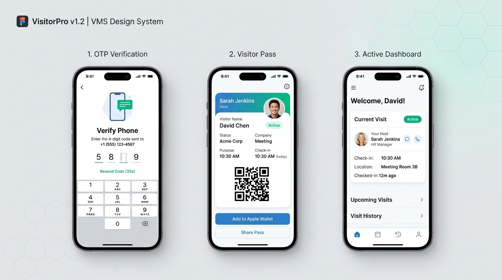
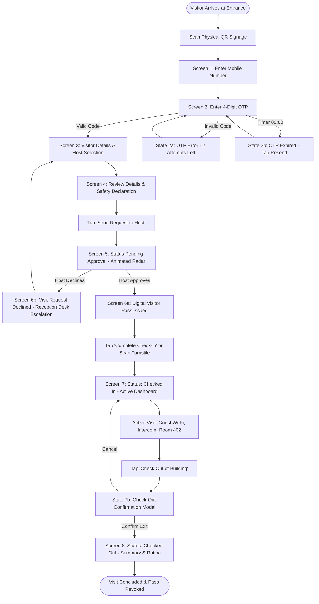

# SwiftPass VMS — Visitor Check-in & Check-out Experience
> **UI/UX Design Assignment for Figma**  
> A simple, fast, and frictionless Visitor Management System (VMS) mobile-first experience starting from an entrance QR code scan.



---

## 📌 Project Overview
* **Objective**: Design a simple and user-friendly Visitor Management System (VMS) that makes visitor check-in and check-out quick, clear, and easy to use.
* **Trigger**: Physical QR code displayed at the office reception / entrance.
* **Target Viewport**: Mobile Responsive Web / Progressive Web App (PWA) — 390 × 844 px (iPhone 14/15/16 baseline).
* **Core Philosophy**: Zero app download friction, live host approval transparency, dynamic Apple Wallet-style digital badge, and 1-tap autonomous check-out.

---

## 🚀 Live Interactive Prototype
An interactive, standalone web prototype is included in this repository.
You can run it locally with any browser:
```bash
# Option 1: Double-click index.html or open directly in Chrome/Edge/Safari

# Option 2: Run a lightweight local HTTP server
python -m http.server 5500
# Then visit: http://localhost:5500
```

### Prototype Features:
- **Interactive Journey**: Entrance QR Scan → Phone Registration → OTP Verification → Visit Details & Host Picker → Review & Consent → Live Radar Approval → Digital Visitor Pass → Turnstile Gate Check-in → Active Status Dashboard → Check-out Confirmation Sheet → Checked-out Summary Receipt.
- **Edge Cases & UX States Controller**: Toggle between OTP Error, OTP Expired, Host Declined / Rejected, and Check-out Modal.
- **Multi-View Modes**:
  1. *Interactive Prototype* (iPhone 15 frame with live time counter and controls)
  2. *Figma Mockup UI* (High-res presentation board preview)
  3. *All Screens Grid* (Inspect all 9 mobile layouts simultaneously)
  4. *User Flow & IA* (Complete journey architecture)
  5. *Figma Specs & Rationale* (1-tap copy design tokens and case study writeup)

---

## 🗺️ Visitor Journey & Decision Flow



---

## 🎨 Design System & Tokens

### Color Palette

| Token | Hex | Role |
| :--- | :--- | :--- |
| **Brand Primary** | `#2563EB` | Primary CTAs, active focus rings, key links |
| **Status: Pending** | `#F59E0B` | Approval waiting badge, radar pulse ring |
| **Status: Approved / Active** | `#10B981` | Approved pass badge, checked-in status banner |
| **Status: Error / Rejected** | `#EF4444` | OTP error outlines, request rejection banner |
| **Status: Checked Out** | `#64748B` | Completed visit status badge, deactivated pass |
| **Surface Background** | `#F8FAFC` | App screen background |
| **Card Surface** | `#FFFFFF` | Form containers, ticket cards, bottom sheets |
| **Text Primary** | `#0F172A` | Primary headings, labels, visitor names |
| **Text Secondary** | `#475569` | Helper copy, microcopy, timestamp labels |

### Typography Scale (Inter / SF Pro Display)
* **Title 1**: `22px` | SemiBold (600) | Line-height `28px` *(Screen Titles)*
* **Headline**: `16px` | Bold (700) | Line-height `24px` *(Card Headers, Visitor Names)*
* **Body Regular**: `13px` | Regular (400) | Line-height `18px` *(Field Inputs, Explanations)*
* **Caption / Overline**: `11px` | SemiBold (600) | Uppercase | Letter spacing `+0.5px` *(Status Badges, Badge IDs)*

---

## 📱 Screen Breakdown (9 High-Fidelity Views)

1. **Entrance QR Poster**: Physical reception sign with scannable QR code and security reassurance badges.
2. **Phone Registration**: E.164 phone input (`+91`) with ISO/IEC 27001 privacy disclaimer.
3. **OTP Verification & States**: 4-box PIN auto-focus with countdown timer, OTP Error, and OTP Expired states.
4. **Visitor Details & Host Selection**: Full name, company, 1-tap Purpose chips (`Meeting`, `Interview`, `Vendor`, etc.), and searchable host card for **Sarah Jenkins** (VP Product Design • Room 402).
5. **Review & Building Safety Declaration**: High-contrast summary invoice with required building health/safety checkbox.
6. **Approval Pending (Radar State)**: Live pulsing radar animation communicating host notification via Slack/SMS with average SLA under 2 minutes.
7. **Digital Visitor Pass (Approved)**: Apple Wallet-style ticket with dynamic rotating turnstile QR token, badge ID `#NX-9421`, and room location.
8. **Active Checked-In Dashboard**: Sticky status banner (`CHECKED IN • ACTIVE`), live elapsed visit clock, 1-tap Guest Wi-Fi copy, reception intercom call, and prominent Check-Out CTA.
9. **Checked-Out Summary Receipt**: Concluded visit receipt with total duration (`1 hr 33 mins`), exit timestamp (`12:15 PM`), and 5-star experience rating.

---

## ⚡ Key UX Decisions & Rationale

1. **Zero App Download Barrier**: Scanning the entrance QR opens an instant Progressive Web App in Safari/Chrome. Eliminating the App Store install removes a 60%+ visitor drop-off barrier.
2. **Progressive Disclosure**: Breaking onboarding into 4 bite-sized steps prevents form fatigue and speeds up registration to under 45 seconds.
3. **Transparent Waiting Experience**: Solves the lobby "black-hole" anxiety by showing live notification status and an average wait time SLA.
4. **Autonomous 1-Tap Check-out**: Solves the enterprise "ghost visitor" problem (visitors walking out without logging out) by keeping a persistent, 1-tap Check-Out button on their active dashboard.
5. **Graceful Rejection Handling**: If a host is unavailable or declines, the visitor is provided clear guidance to front desk reception or given 1-tap actions to contact the host.

---

## 📁 Repository Structure
```
├── index.html           # Full interactive prototype with state machine & inspector
├── vms_ui_mockup.jpg    # High-resolution Figma presentation board visual
└── README.md            # Complete documentation, user flow, and design system specs
```
